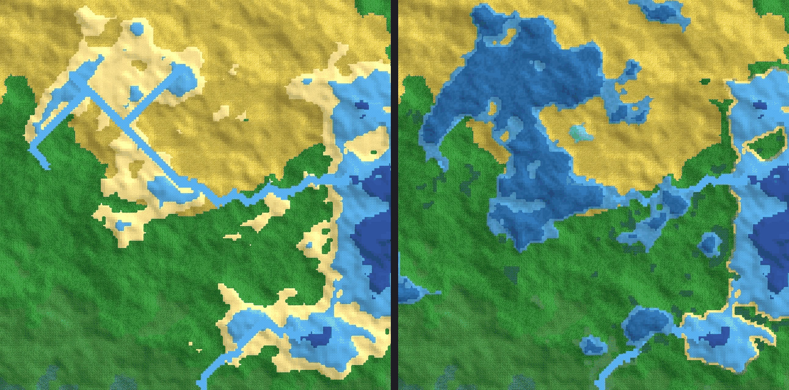
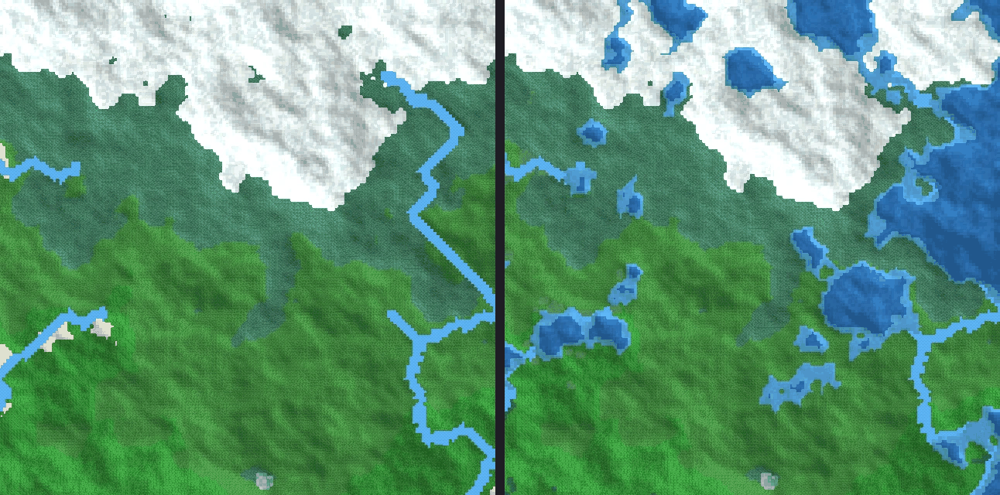
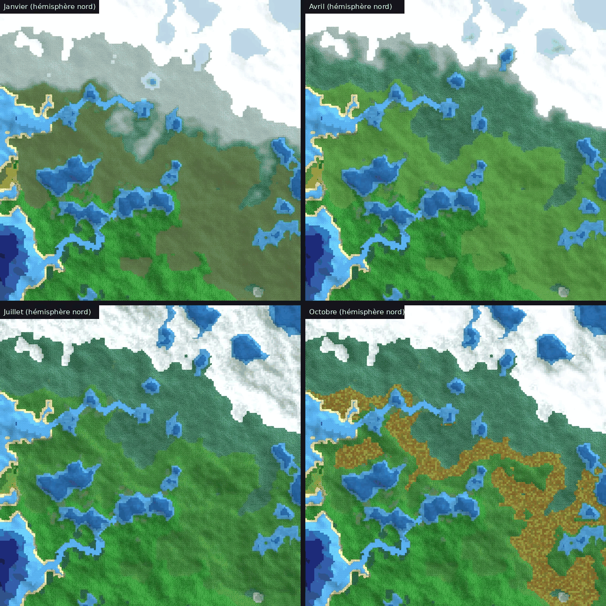

# C1 — Monde : eaux, côtes, saisons, occupation du sol et relief

Séance de conception préalable à la phase 1 · 8 novembre 2026 · statut : validé le 8 novembre 2026

## Objet

Cette séance tranche les questions 6, 7 et 8 du PRD (section 27) : biomes anthropiques, lacs et marais, saisons. Elle traite aussi les décisions dont la phase 1 a besoin et que la carte de test a mises en évidence : niveau de la mer, niveaux d'altitude, relief et climat.

Les propositions s'appuient sur un prototype branché sur le pipeline de `testMap_filtre.ipynb`. Il a été appliqué à une carte de 512 × 512 cases (graine 263562). Les scripts sont dans `prototypes/c1/` et les images dans `docs/design/C1/`.

## Résumé des décisions

| # | Décision | Prio |
|---|---|---|
| D1 | Un seul niveau de la mer. Seules les eaux reliées à l'océan mondial sont des mers ; les bassins fermés relèvent des lacs. | P0 |
| D2 | Lacs par bilan hydrique : lac d'eau douce, lac salé ou salar. | P0 |
| D3 | Rivières en trois classes (ruisseau, rivière, fleuve), sans tronçons rectilignes. | P0, puis P1 |
| D4 | Côtes typées sur une seule rangée de cases : plage, côte rocheuse, falaise, mangrove, marais littoral. | P0 |
| D5 | Zones humides : marais, tourbière, marécage. | P0, puis P1 |
| D6 | Liste des biomes naturels complétée : 32 biomes. | P0 |
| D7 | Occupation du sol : une couche distincte du biome naturel, avec succession écologique. | P0, puis P1 |
| D8 | Calendrier de 12 mois, saisons inversées entre hémisphères, amplitude selon la latitude et la continentalité. | P0 |
| D9 | Effets des saisons : rendements, neige et glace d'abord ; guerre, végétation et fêtes ensuite. | P0, puis P1 |
| D10 | Saisons rendues par shader, sans recuire les blocs de carte. | P0 |
| D11 | 20 niveaux d'altitude définis en mètres, avec leurs effets. | P0 |
| D12 | Relief : ajout de chaînes de montagnes. | P0 |
| D13 | Climat : températures et précipitations recalibrées ; biomes classés selon le mois le plus chaud et le plus froid. | P0 |

## Ce que révèle la carte de test

| Constat | Mesure | Décision |
|---|---|---|
| Deux niveaux de la mer | 0,45 pour les biomes, 0,40 pour l'hydrologie | D1 |
| Mers fermées | 59 masses d'eau sous le niveau de la mer, toutes traitées comme de l'océan | D1, D2 |
| Plages trop larges | 14,1 % des terres, car la plage dépend du seul seuil d'altitude | D4 |
| Rivières rectilignes | Segments droits dans les dépressions remplies : un artefact du priority flood sur les zones plates | D2, D3 |
| Pas de vraies montagnes | 99 % des terres sous 0,45 de hauteur normalisée ; avec la correspondance de D11, 3 280 m au plus et aucun sommet | D12 |
| Climat trop chaud | 35 °C de moyenne annuelle sur la bande équatoriale, jusqu'à 45 °C par endroits ; seulement 3,5 °C vers les pôles | D13 |
| Humidité trop uniforme | 80 % des cases entre 0,45 et 0,75 ; aucun désert ni aucune steppe sur la carte | D13 |
| Neige permanente en été | La « neige » est un biome tiré de la moyenne annuelle : elle reste blanche en juillet | D8, D13 |

## D1. Niveau de la mer et océan

Un seul paramètre « niveau de la mer » sert partout : biomes, hydrologie, côtes.

Est mer toute eau reliée à l'océan mondial, c'est-à-dire :
- la plus grande masse d'eau connexe ;
- toute autre masse d'eau dépassant un seuil de taille relatif à la carte, par exemple 2 % de sa surface.

Les autres bassins sont fermés, quelle que soit leur altitude, et relèvent des lacs (D2). C'est le cas réel de la Caspienne ou de la mer Morte, dont le niveau ne dépend pas de celui de l'océan mais de leur bilan hydrique.

Le remplissage des dépressions (priority flood) part donc de l'océan seul, et la couture est-ouest est continue (voisins pris modulo la largeur).

## D2. Lacs

Le modèle procède en trois temps.

**1. Bassins significatifs seulement.** Le remplissage des dépressions donne, pour chaque bassin, son niveau de débordement. Le bruit fractal crée des cuvettes partout, alors qu'un relief réel est drainé par l'érosion. Seuls les bassins assez grands et assez profonds forment donc des lacs (prototype : au moins 60 cases et 0,012 de profondeur). Les autres sont drainés et peuvent accueillir des zones humides (D5).

**2. Bilan hydrique par bassin.** On compare :
- l'apport, c'est-à-dire le ruissellement de tout le bassin versant, accumulé le long des écoulements ;
- l'évaporation, égale à la surface du lac multipliée par un taux qui croît avec la température et baisse avec l'humidité.

**3. Résultat.**

| Cas | Lac | Effets de jeu |
|---|---|---|
| Apport ≥ évaporation au niveau de débordement | Lac d'eau douce, rempli jusqu'au débordement ; la rivière repart de l'exutoire. | Eau potable, pêche, navigation en barque, rives fertiles. |
| Apport < évaporation | Lac salé, sans exutoire. Il ne remplit que la partie basse du bassin, la surface que l'apport peut entretenir. Les rivières en aval disparaissent. | Sel, pas d'eau potable. |
| Apport très faible (moins de 12 % de l'évaporation) | Salar : une étendue de sel sèche, plate et émergée. | Sel, déplacement facile, terre stérile. |

Les lacs ont des eaux peu profondes et profondes, rendues par deux teintes. Les cinq niveaux d'eau de D11 s'y appliquent à partir de leur surface. En hiver, les lacs gèlent selon la température du mois (D9).

**Résultat du prototype :**
- 83 lacs d'eau douce, 3 lacs salés et aucun salar, sur une carte très humide (D13 créera des zones arides) ;
- les lacs remplacent les rivières rectilignes, qui traversaient justement les dépressions remplies.

Les lacs couvrent toutefois 10 % de la carte. C'est trop, parce que la carte de test est un morceau de continent avec 80 % de terres. Ce chiffre est à recalibrer sur un vrai monde cylindrique.





## D3. Rivières

| Classe | Débit | Franchissement | Navigation |
|---|---|---|---|
| Ruisseau | du seuil de rivière à 4 fois ce seuil | partout | aucune |
| Rivière | de 4 à 16 fois le seuil | à gué par endroits, ou par un pont | barques et barges |
| Fleuve | plus de 16 fois le seuil | pont ou bac | barges et voiliers ; frontière naturelle |

La largeur dessinée reste logarithmique, comme dans le prototype. Les rivières gèlent en hiver selon la température du mois. La géométrie relève du premier jalon, et les règles de franchissement et de navigation de la version 1 (MON-07).

Pour supprimer les tronçons rectilignes restants, le portage remplit les zones plates avec une pente minimale (variante « epsilon » du priority flood). Les égalités se départagent par un tirage déterministe.

## D4. Côtes

Seule la première rangée de cases de terre au contact de la mer reçoit un type côtier. Les anciennes plages intérieures retrouvent le biome de leur climat.

| Type | Condition (prototype) | Effets de jeu |
|---|---|---|
| Plage | côte basse, climat non froid | débarquement facile, pêche, salines possibles (D7) |
| Côte rocheuse | climat froid (moins de 3 °C), ou relief modéré (70e centile du relief côtier) | débarquement difficile |
| Falaise | relief fort (88e centile du relief dans un rayon de 2 cases) | aucun débarquement, position défensive |
| Mangrove | 24 °C ou plus, humide, plat | bois, pêche, maladies, déplacement lent |
| Marais littoral | de 8 à 24 °C, très humide, plat | sel, pâturage, maladies |

Résultat du prototype : la plage passe de 14,1 % à 1,9 % des terres, et falaises et côtes rocheuses apparaissent sur les côtes élevées. Les rives des lacs restent pour l'instant ordinaires, avec des zones humides là où les conditions de D5 sont réunies.

## D5. Zones humides

Une zone humide se forme sur un terrain plat et bas, très humide, près d'une eau (moins de 4 cases) ou dans une petite dépression drainée (D2).

| Type | Climat | Ressources | Effets de jeu |
|---|---|---|---|
| Marais | de 3 à 22 °C | roseaux (toitures), pêche, gibier d'eau | déplacement lent, maladies ; très fertile une fois asséché |
| Tourbière | moins de 3 °C | tourbe (combustible), fer des marais | déplacement lent, peu fertile |
| Marécage | 22 °C ou plus | bois, gibier | déplacement très lent, maladies |

La mangrove est la zone humide des côtes tropicales (D4).

L'assèchement est prévu en version 1. Avec le savoir « canaux » (artisanat et industrie), un marais peut être asséché et devient une terre agricole très fertile. Si les canaux ne sont plus entretenus, le marais revient (D7). Le fer des marais offre aux premières civilisations une source de fer accessible sans mine.

Résultat du prototype : 1,9 % des terres, soit 1 749 cases de marais, 49 de tourbière et 2 079 de marécage.

## D6. Biomes naturels

La liste du prototype est conservée et complétée. Les ajouts sont en italique.

| Famille | Biomes |
|---|---|
| Eaux | océan profond, océan, océan côtier, rivière, *lac*, *lac salé* |
| Côtes | plage, *côte rocheuse*, *falaise*, *mangrove*, *marais littoral* |
| *Zones humides* | *marais*, *tourbière*, *marécage* |
| Froids | *glacier* (l'ancienne « neige »), toundra, taïga, forêt froide, steppe froide |
| Montagne | alpin, montagne, haute montagne |
| Tempérés | prairie, steppe, forêt tempérée, forêt pluviale tempérée |
| Arides | désert, *salar* |
| Chauds et tropicaux | savane, prairie tropicale, forêt tropicale, forêt pluviale |

La « neige » du prototype devient « glacier » : une glace permanente, là où même le mois le plus chaud reste sous 0 °C (D13). La neige saisonnière n'est plus un biome mais une couche calculée chaque mois (D8 à D10).

## D7. Occupation du sol

Chaque case porte deux informations distinctes :
- son **biome naturel**, issu de la génération, qui ne change que par les pouvoirs du Créateur, l'assèchement d'un marais ou une évolution lente du climat ;
- son **occupation du sol**, dynamique : aucune, ou un type assorti d'un âge.

L'affichage montre l'occupation s'il y en a une, sinon le biome naturel. Sans entretien, l'occupation évolue d'elle-même vers le biome naturel : c'est la succession écologique.

| Type | Créé par | Évolution sans entretien | Prio |
|---|---|---|---|
| Grandes cultures | défrichement et labour, en champs ouverts | friche | P0 |
| Pâturages | élevage | prairie | P0 |
| Coupe | abattage d'une forêt | jeune forêt | P0 |
| Friche | abandon d'une terre cultivée | broussailles, jeune forêt, puis biome naturel | P0 |
| Zone bâtie | village, ville | ruines | P0 |
| Bocage | champs et pâtures bordés de haies, selon la culture | friche | P1 |
| Cultures irriguées | canaux : rizières, oasis, vallées arides | friche, ou désert en zone aride | P1 |
| Terrasses | cultures en terrasses sur les collines | friche | P1 |
| Vergers et vignes | cultures pérennes | friche | P1 |
| Terre brûlée | incendie, tactique de la terre brûlée | friche | P1 |
| Terre ravagée | bataille | friche | P1 |
| Carrière, mine | extraction | friche, lentement | P1 |
| Salines | marais salants sur une plage ou un marais littoral | marais littoral | P1 |
| Ruines | abandon d'une zone bâtie | ruines durables, découvrables en Saga, peu à peu recouvertes | P1 |

Durées de la succession, pour un biome naturel forestier :
- friche, de 0 à 5 ans ;
- broussailles, de 5 à 20 ans ;
- jeune forêt, de 20 à 60 ans ;
- puis le biome naturel.

Pour un biome naturel non forestier, la friche rejoint le biome naturel en 5 à 10 ans.

Bocage ou grandes cultures : le choix dépend du paysage agraire de la culture et du terrain. Routes, ponts et canaux forment une couche linéaire à part.

## D8. Calendrier et saisons

L'année compte 12 mois, et le pas de temps reste le mois. Chaque saison dure trois mois. Le joueur suit un calendrier universel, l'« an du monde ». Les calendriers locaux, avec des noms de mois propres à chaque langue et des ères, viendront en version 1.

L'hémisphère nord occupe la moitié haute de la carte et l'hémisphère sud la moitié basse, et les saisons y sont inversées. La température d'un mois se calcule ainsi :

```
T_mois = T_annuelle + A × cos(2π × (mois − 6,5) / 12) × s
s = +1 au nord, −1 au sud       (mois : 0 = janvier)
A = (1 + 15 × |latitude|^1,3) × (0,75 + 0,5 × continentalité)
```

`A` est la demi-amplitude annuelle. Elle vaut environ 1 °C à l'équateur et 7 à 13 °C aux latitudes moyennes, et peut atteindre 20 °C au cœur des continents proches des pôles. La continentalité est déjà calculée par le prototype.

Sous les tropiques, la température varie peu ; c'est la pluie qui fait la saison. La saison sèche correspond à l'hiver local, et la saison des pluies à l'été.

Résultat du prototype : en janvier, la neige couvre 28 % des terres du nord et aucune terre du sud ; en juillet, c'est l'inverse.



L'animation `C1/saisons.gif` montre les douze mois sur toute la carte.

## D9. Effets des saisons

| Domaine | Effet | Prio |
|---|---|---|
| Climat | Température mensuelle de chaque case. | P0 |
| Agriculture | Semailles au printemps, récoltes en été et en automne selon la latitude. La saison de croissance raccourcit en altitude et vers les pôles. Il faut des réserves pour passer l'hiver. | P0 |
| Cueillette, chasse, pêche | Rendements variables selon la saison. | P0 |
| Démographie | Mortalité accrue des plus fragiles en hiver. | P0 |
| Visuels | Neige saisonnière, glace sur les lacs et les rivières, banquise côtière. | P0 |
| Visuels | Couleurs d'automne, arbres nus, herbe sèche, saison sèche des tropiques. | P1 |
| Guerre | Saison de campagne, attrition hivernale, boue au dégel, lacs et rivières gelés franchissables, tempêtes en mer. | P1 |
| Construction | Chantiers ralentis en hiver. | P1 |
| Saga et religions | Fêtes saisonnières, solstices et équinoxes, rites des récoltes. | P1 |
| Aléas | Bonnes et mauvaises années (sécheresses, hivers rigoureux) qui pèsent sur les récoltes. | P1 |

## D10. Rendu des saisons

Les blocs de carte sont cuits une seule fois (tâche 1.7 du plan) ; un shader applique ensuite les saisons. Il reçoit le mois en paramètre et lit une texture de données, à raison d'un texel par case. Cette texture contient :
- la température annuelle ;
- la demi-amplitude ;
- l'hémisphère ;
- le type de végétation : persistante, caduque, herbe, herbe tropicale, toundra, aucune ;
- le type d'eau : eau douce gelable, mer côtière.

Le shader en déduit la neige, la glace et la teinte de la végétation, pixel par pixel. Les transitions d'un mois à l'autre sont continues, et rien n'est recuit, ce qui ne coûte rien même en vitesse maximale.

Pour rester fidèle au pixel art, le shader recolore par palettes saisonnières propres à chaque biome. Il évite donc le mélange libre de couleurs du prototype, qui crée des teintes hors palette.

Conséquences pour la phase 1 :
- la tâche 1.7 produit la texture de données ;
- la neige et la glace sont rendues dès le premier jalon ;
- les teintes de végétation viennent en version 1.

## D11. Niveaux d'altitude

Les 20 niveaux du brief sont définis en mètres, ce qui rend le relief lisible et cohérent avec le climat. La correspondance avec la hauteur générée `h` (dans [0, 1]) est la suivante :

```
terres : altitude = 7 000 m × hn^1,6     avec hn = (h − mer) / (1 − mer)
mers   : profondeur = 5 500 m × dn^1,4   avec dn = (mer − h) / mer
```

La température baisse de 6,5 °C par 1 000 m. Les coefficients ci-dessous multiplient ceux du biome.

| Niveau | Altitude | Déplacement | Fertilité | Constructions | Carte de test |
|---|---|---|---|---|---|
| Eau 5 — abysses | sous −4 000 m | haute mer | — | — | 0 % des eaux |
| Eau 4 — océan | −4 000 à −1 000 m | haute mer | — | — | 2,4 % des eaux |
| Eau 3 — talus | −1 000 à −200 m | large | — | — | 40,9 % des eaux |
| Eau 2 — plateau continental | −200 à −50 m | près des côtes | — | — | 32,2 % des eaux |
| Eau 1 — eaux côtières | −50 à −5 m | cabotage | — | — | 19,4 % des eaux |
| Rivage 1 — estran | −5 à 0 m | gué à marée basse (TER-05) | — | — | 5,1 % des eaux |
| Rivage 2 — haut de plage | 0 à 5 m | × 1 | × 0,7 | ports, salines | 2,7 % des terres |
| Plaines 1 à 5 | 5–50, 50–100, 100–200, 200–300, 300–400 m | × 1 | × 1 | toutes | 46,6 % des terres |
| Collines 1 à 3 | 400–600, 600–800, 800–1 000 m | × 1,5 | × 0,8 | toutes ; châteaux favorisés | 35,3 % des terres |
| Basses montagnes 1 et 2 | 1 000–1 400, 1 400–1 800 m | × 2,5 | × 0,5 | villages, mines, forts | 14,0 % des terres |
| Moyenne montagne | 1 800–2 600 m | × 4 | × 0,25 (pastoralisme) | hameaux, mines, forts | 1,2 % des terres |
| Haute montagne | 2 600–3 800 m | × 6 | 0 | mines, cols fortifiés | 0,2 % des terres |
| Sommet | plus de 3 800 m | infranchissable pour les armées | 0 | aucune ; lieu sacré possible | 0 % des terres |

En version 1, la navigation dépendra des savoirs maritimes :
- barques et barges : rivières, lacs et eaux côtières ;
- voiliers : jusqu'au talus ;
- galions et vapeurs : toutes les eaux.

La pente s'ajoutera alors au coût de déplacement.

## D12. Relief : des chaînes de montagnes

Le bruit fractal du prototype produit des terres vallonnées, mais aucune chaîne de montagnes : la carte de test culmine à 3 280 m et n'a aucun sommet.

Proposition : ajouter un bruit de crêtes, de la forme `1 − |bruit|`. Il est modulé par un champ de très basse fréquence, qui décide où se dressent les chaînes : il en résulte de longues lignes de crêtes, entrecoupées de cols. Des plaques tectoniques simulées (Voronoï) pourront venir plus tard.

Cible : 3 à 6 % des terres au-dessus de la moyenne montagne, avec des crêtes continues sur des dizaines de cases. Les cols deviennent des passages stratégiques, et les montagnes portent les sources des rivières, les neiges et l'ombre pluviométrique (D13). Un paramètre « relief », de plat à montagneux, s'ajoute à l'écran de création.

## D13. Climat

**1. Températures recalibrées.** Cible : environ 27 °C de moyenne annuelle à l'équateur et −25 °C aux pôles, avant l'effet de l'altitude (D11). Le paramètre « température moyenne » décale l'ensemble. La carte de test affiche 35 °C sur la bande équatoriale et seulement 3,5 °C vers les pôles.

**2. Précipitations par un modèle simple.** Ce modèle remplace le bruit d'humidité, quasi uniforme, et combine trois éléments :
- des bandes de latitude : un équateur humide, une zone sèche vers 30°, des latitudes moyennes humides vers 50 à 60°, des pôles secs ;
- des vents dominants par bande : alizés d'est sous les tropiques, vents d'ouest aux latitudes moyennes, vents d'est polaires. Ils portent l'humidité de la mer et la perdent au-dessus des terres. Le monde cylindrique s'y prête bien, puisque ces vents font le tour du monde ;
- la pluie de relief sur les versants exposés au vent, et l'ombre pluviométrique derrière les montagnes.

On obtient des déserts subtropicaux et des déserts d'abri, des forêts pluviales à l'équateur et des façades océaniques humides. La carte de test, elle, n'a aucun désert.

**3. Biomes classés par mois.** Les températures du mois le plus froid et du mois le plus chaud (D8), avec les précipitations annuelles, classent les biomes, comme dans la classification de Köppen. La liste de D6 ne change pas. Quelques règles :
- glacier si le mois le plus chaud reste sous 0 °C ;
- toundra ou alpin s'il reste sous 10 °C : c'est la limite des arbres ;
- taïga si le mois le plus froid descend sous −3 °C et que le plus chaud dépasse 10 °C ;
- climats tropicaux si le mois le plus froid dépasse 18 °C.

La limite des arbres devient réaliste, et il n'y a plus de neige permanente en été.

Coût : quelques jours de plus en phase 1. La classification du prototype reste disponible en solution de repli.

## Impacts sur le PRD et le plan

Ces décisions sont intégrées au PRD (version 0.3) :
- MON-04 (pipeline) intègre D1, D2, D3, D12 et D13 ;
- MON-05 et MON-06 reprennent les niveaux et leurs effets (D11), et MON-07 les classes de rivières (D3) ;
- MON-08 adopte la liste de D6, et MON-09 devient l'occupation du sol (D7) ;
- de nouvelles exigences couvrent les lacs (MON-11), les côtes (MON-12), les zones humides (MON-13), le relief (MON-14), le climat (MON-15), les saisons (SAI-01 à SAI-05), leur rendu (REN-10) et les ressources des milieux humides et salés (RES-05) ;
- les questions 6, 7 et 8 sont closes.

Le plan (version 0.2) en tient compte pour la phase 1 :

| Tâche | Ajout |
|---|---|
| 1.2 | chaînes de montagnes (D12) et correspondance en mètres (D11) |
| 1.3 | modèle de climat (D13) et températures mensuelles (D8) |
| 1.4 | océan (D1), lacs (D2), classes de rivières et zones plates (D3) |
| 1.5 | biomes par mois (D13), côtes (D4), zones humides (D5), liste complète (D6) |
| 1.7 | texture de données des saisons (D10) |
| 1.8 | rendu de la neige et de la glace (D10) |

La phase 1 grossit de quelques jours, surtout pour le relief et le climat. Elle reste de taille L.

Pour les phases 2 et 3, les rendements saisonniers (D9) entrent dans la subsistance, et les cinq occupations du sol P0 (D7) entrent dans la phase 3.

## Paramètres du prototype

Ces valeurs ont été calées sur la carte de test et seront recalibrées en phase 1 sur un vrai monde cylindrique.

| Paramètre | Valeur | Rôle |
|---|---|---|
| Taille minimale d'une mer fermée | 1 500 cases | carte de test seulement : elle n'a pas d'océan mondial |
| Surface minimale d'un lac | 60 cases | élimine les cuvettes du bruit |
| Profondeur minimale d'un lac | 0,012 | idem |
| Coefficient d'évaporation | 2,5 | sépare lacs d'eau douce et lacs salés |
| Seuil du salar | 12 % de l'évaporation | en dessous, le bassin est sec |
| Pente des zones humides | 40 % des terres les plus plates | — |
| Distance à l'eau des zones humides | 4 cases | — |
| Humidité minimale des zones humides | 0,52 | — |
| Falaise, côte rocheuse | 88e et 70e centiles du relief côtier | — |
| Demi-amplitude saisonnière | (1 + 15 × \|lat\|^1,3) × (0,75 + 0,5 × continentalité) | D8 |

## Fichiers

| Fichier | Contenu |
|---|---|
| `docs/design/C1/avant-apres-tropiques.png` | Zone tropicale, avant et après : plages, lac, lac salé, marécages |
| `docs/design/C1/avant-apres-nord.png` | Zone boréale, avant et après : lacs à la place des rivières rectilignes |
| `docs/design/C1/saisons-nord.png` | Janvier, avril, juillet et octobre dans l'hémisphère nord |
| `docs/design/C1/saisons.gif` | Les douze mois sur toute la carte |
| `prototypes/c1/lacs_cotes_zones_humides.py` | Lacs, côtes et zones humides, à insérer dans le pipeline du notebook |
| `prototypes/c1/saisons.py` | Températures mensuelles et recoloration saisonnière |
