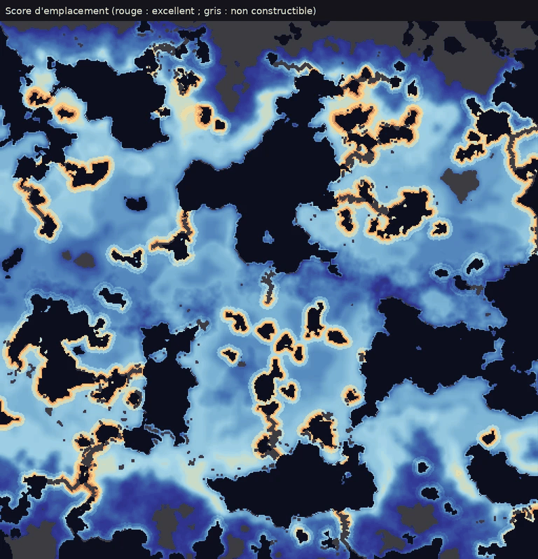
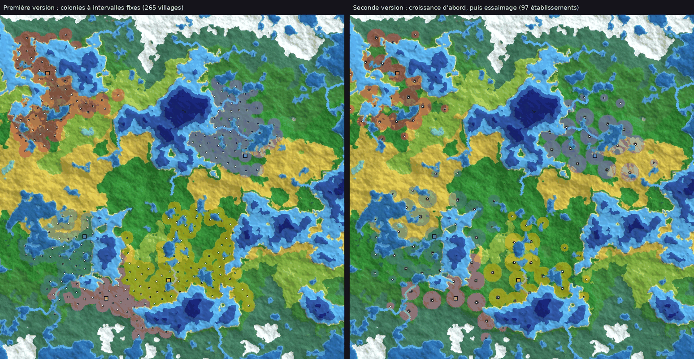
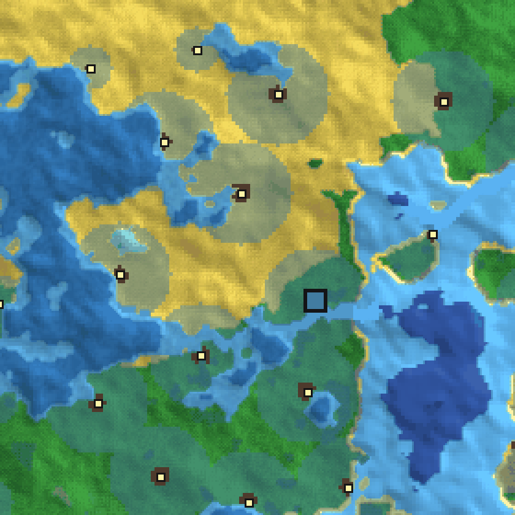
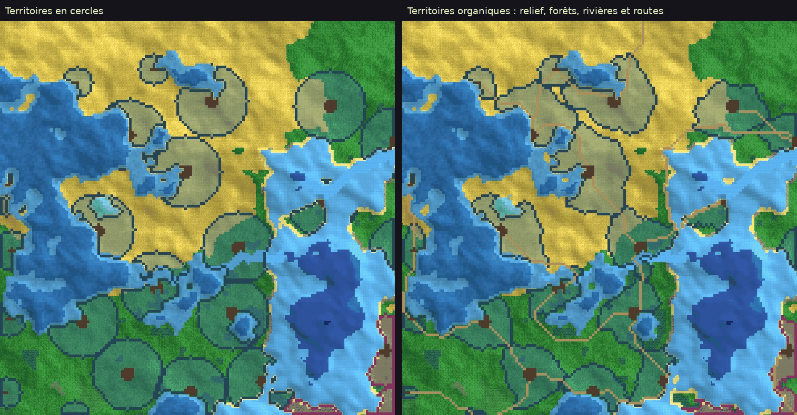

# C2 — Peuples : civilisations, cultures, fondations et villages

Séance de conception préalable à la phase 3 · 9 novembre 2026 · statut : validé le 9 novembre 2026

## Objet

Cette séance tranche la question 3 du PRD (section 27) : comment un individu et un village appartiennent-ils à une civilisation et à une culture ? Elle précise aussi la fondation (CIV-01) et le fonctionnement des villages, ainsi que les premiers savoirs, dont la phase 3 a besoin.

La diffusion des cultures, des langues et des religions reste l'objet de la séance C7. La forme politique des villages relève de la séance C3.

Les propositions sur l'emplacement des villages et les colonies s'appuient sur un prototype appliqué à la carte de test de C1 (512 × 512 cases). Le script est dans `prototypes/c2/` et les images dans `docs/design/C2/`.

## Résumé des décisions

| # | Décision | Prio |
|---|---|---|
| D1 | Civilisation, culture, langue, religion et gouvernement sont cinq identités distinctes. La relation entre civilisations et cultures découle des individus et des villages. | P0 |
| D2 | Un individu hérite sa culture de son foyer ; sa civilisation est celle du village où il vit. | P0 |
| D3 | Un village appartient à une seule civilisation et réunit les cultures de ses habitants. La conquête ne change pas sa civilisation ; l'assimilation, oui. | P0, puis P1 |
| D4 | Avant toute civilisation, les humains vivent en groupes nomades, dotés dès leur apparition d'une langue et d'une culture embryonnaires. | P0 |
| D5 | Conditions et déroulement de la fondation d'une civilisation. | P0 |
| D6 | Caractéristiques initiales : savoirs de départ selon le milieu, traits culturels tirés à la fondation. | P0, puis P1 |
| D7 | Score d'emplacement des villages. | P0 |
| D8 | Vie d'un établissement : il grandit et défriche son territoire jusqu'à le saturer. | P0 |
| D9 | Colonies : un village n'essaime que lorsqu'il ne peut plus s'étendre. | P0 |
| D10 | Évolution des cultures et des civilisations : scissions, fusions, extinctions. | P1 |
| D11 | Langues et noms, avec un petit lexique de racines dès le premier jalon. | P0, puis P1 |
| D12 | Les onze premiers savoirs, dont l'élevage. | P0 |
| D13 | Échelle de la carte : pas de kilomètres fixes ; l'espacement des établissements découle du budget de population. | P0 |
| D14 | Territoires organiques : l'influence se propage depuis les bâtiments selon le coût de déplacement, et suit les routes. | P0, puis P1 |

## D1. Cinq identités distinctes

| Identité | S'applique à | Porte | Change par |
|---|---|---|---|
| Civilisation | des villages | la maîtrise des savoirs, un nom, une histoire | fondation, colonies, assimilation, scission, extinction |
| Culture | des individus | les coutumes (nommage, architecture, vêtements, valeurs, succession…) et une langue | fondation, scission, fusion, disparition |
| Langue | des individus | sons, mots, noms | naissance avec une culture, divergence |
| Religion | des individus | voir la séance C7 | voir la séance C7 |
| Gouvernement | des villages | le pouvoir politique | voir la séance C3 |

La civilisation s'attache aux villages et la culture aux individus. La relation libre entre les deux (CIV-03) en découle sans table à entretenir :
- les cultures d'une civilisation sont celles des habitants de ses villages ;
- les civilisations d'une culture sont celles des villages où vivent ses membres.

Des agrégats recalculés chaque année servent à l'affichage et aux statistiques.

Civilisation et gouvernement sont aussi indépendants. Une civilisation peut se partager entre plusieurs royaumes rivaux, et un royaume peut gouverner des villages de plusieurs civilisations.

## D2. Appartenance des individus

**Culture.** À la naissance, l'enfant reçoit la culture de son foyer :
- si ses parents partagent la même culture, c'est la sienne ;
- sinon, il reçoit celle des deux qui est la plus répandue dans son village de naissance ;
- à égalité, celle du parent qui transmet le nom de famille, selon les règles de nommage.

L'acculturation au cours de la vie viendra en version 1, avec la séance C7.

**Langues.** La langue maternelle est celle de la culture reçue à la naissance. Les langues apprises (bilinguisme des villages mêlés, langues du commerce et de l'administration) viendront en version 1.

**Civilisation.** C'est celle du village où vit l'individu. Les membres d'un groupe nomade n'en ont pas (D4). Chacun garde la trace de sa civilisation d'origine, pour l'histoire et pour le mode Saga.

**Migration.** Un individu qui s'installe dans un village d'une autre civilisation la rejoint aussitôt, avec sa culture, sa langue et ses compétences. Ses compétences peuvent transmettre un savoir à sa nouvelle civilisation (SAV-03, séance C5).

## D3. Appartenance des villages

Un village appartient à une seule civilisation. Sa composition culturelle découle de ses habitants. Sa culture dominante, celle de la majorité ou à défaut de la plus grande part, décide du style de ses nouveaux bâtiments (ARC-01).

| Événement | Effet sur la civilisation du village | Prio |
|---|---|---|
| Fondation | une nouvelle civilisation naît (D5) | P0 |
| Colonie | la colonie appartient à la civilisation du village mère (D9) | P0 |
| Conquête | aucun effet direct : le village change de gouvernement, pas de civilisation | P0 |
| Assimilation | le village rejoint une autre civilisation quand son affinité pour elle dépasse, vingt ans d'affilée, son affinité pour la sienne | P1 |
| Abandon | le village devient des ruines (C1, D7) et sa civilisation le perd | P0 |

L'affinité d'un village pour une civilisation combine plusieurs facteurs :
- l'appartenance à un même gouvernement ;
- les contacts : voisinage, routes, commerce ;
- les cultures, langues et religions que partagent ses habitants ;
- le niveau de chaque civilisation.

Une civilisation plus avancée attire, mais une culture prestigieuse peut aussi conquérir son vainqueur. La séance C7 fixe les poids de ces facteurs, puisqu'ils relèvent de la diffusion.

Un village utilise la maîtrise des savoirs de sa civilisation. Un village conquis par une civilisation plus avancée ne reçoit donc pas ses savoirs d'un coup. Il les acquiert par la diffusion entre voisins (SAV-03), ou en rejoignant cette civilisation.

### Exemple

Les Kaltiens fondent leur civilisation au bord d'un lac. Deux siècles plus tard, leurs colonies atteignent une vallée habitée par les Ourmes, une autre civilisation.

Un roi kaltien conquiert alors trois villages ourmes. Ces villages changent de gouvernement, mais restent de civilisation ourme.

Cinquante ans plus tard, l'un d'eux, relié aux villes kaltiennes par une route marchande et gouverné depuis longtemps par des Kaltiens, rejoint la civilisation kaltienne. Ses habitants restent de culture ourme. La civilisation kaltienne compte désormais deux cultures, et la culture ourme existe dans deux civilisations.

## D4. Avant la civilisation : les groupes nomades

Les individus qui apparaissent sans civilisation, par exemple ceux qu'on fait apparaître en mode Créateur, forment un groupe nomade. Dès son apparition, ce groupe reçoit une langue et une culture embryonnaires : il faut une langue pour nommer ses membres. C'est un léger écart avec le brief, où la fondation crée la langue et la culture. Ici, la fondation les fixe et leur donne leurs traits (D6).

Le groupe vit de cueillette, de chasse et de pêche, avec les rendements saisonniers de C1 (D9). Il se déplace au fil des saisons vers les meilleurs terrains de son aire, sans bâtir. Au-delà d'une trentaine de membres, il se scinde en deux groupes de même culture.

Un groupe qui séjourne près d'un village où il reste de la place peut s'y installer, en tout ou en partie. Ses membres rejoignent la civilisation du village (D2) et y apportent leur culture et leur langue. C'est la première source de villages mêlés.

## D5. Fondation d'une civilisation

Un groupe fonde une civilisation quand quatre conditions sont réunies :
1. il compte au moins trois individus de la même espèce, sans civilisation, dont un couple fertile, pour que la civilisation puisse durer ;
2. il trouve dans son aire un site dont le score atteint 0,5 (D7) ;
3. aucun établissement n'existe à moins de 30 cases : c'est le « territoire assez vaste sans village » du brief (D13) ;
4. au moins 60 % des cases sont habitables dans un rayon de 14 cases, celui du futur territoire. Les eaux, glaciers, salars et hautes montagnes ne le sont pas.

Chaque mois où ces conditions sont réunies, le groupe se fixe avec une probabilité de 10 % : en pratique, en moins d'un an. En mode Créateur, l'outil « Fonder ici » force la fondation.

La fondation fait naître :
- une civilisation, nommée dans la langue du groupe (D11) ;
- sa culture, la culture embryonnaire du groupe désormais fixée, avec ses traits (D6) ;
- sa langue, celle du groupe ;
- un village sur le site, avec une hutte par foyer, dont le fondateur devient le chef (D8) ;
- des savoirs de départ (D6).

La chronique enregistre la fondation.

## D6. Caractéristiques initiales

### Savoirs de départ

Toutes les civilisations connaissent la hutte et le bâton. Elles reçoivent en plus jusqu'à deux savoirs, selon les deux milieux qui dominent dans un rayon de 8 cases :

| Milieu autour du site | Savoir de départ |
|---|---|
| côte, lac ou fleuve | barque |
| forêt | coupe du bois |
| plaine fertile près de l'eau douce | culture vivrière |
| prairie, steppe ou colline | élevage |
| savane ou désert | fronde |
| climat froid (taïga, toundra) | armure de cuir |

Ces savoirs commencent avec une maîtrise de 40 %, celle d'une tradition déjà ancienne.

### Traits culturels

| Trait | Tirage à la fondation | Prio |
|---|---|---|
| Règles de nommage | au hasard : prénom seul ; nom hérité du père ou de la mère ; nom obtenu (surnom, métier, lieu) ; mélange | P0 |
| Style architectural | matériaux du milieu (bois, pierre, terre crue, roseaux, peaux), formes tirées au hasard (toits, ouvertures, ornements) | P0 |
| Style vestimentaire | selon le climat (fourrures, laine, lin, pagnes) et une palette de couleurs propre à la culture | P0 |
| Valeurs | guerrière, marchande, pieuse, savante, artistique : au hasard, légèrement orientées par le milieu (côte : marchande ; montagne : guerrière ; plaine fertile : pieuse) | P0 |
| Place des genres et succession | égalitaire, préférence masculine, préférence féminine, exclusive : tirage pondéré, indépendant du milieu | P0, utilisé en phase 4 |
| Règles matrimoniales | monogamie, polygamie… | P1 |
| Doctrines militaires | — | P1 |
| Paysage agraire | bocage ou grandes cultures (C1, D7) | P1 |
| Calendrier local | noms des mois dans la langue (SAI-05) | P1 |
| Style héraldique | — | P2 |

L'espèce pourra orienter ces tirages quand d'autres espèces arriveront (ESP-03).

## D7. Emplacement des villages

Chaque case constructible reçoit un score d'emplacement compris entre 0 et 1 :

```
score = confort × (½ fertilité + ½ eau douce) + 0,1 × côte + 0,1 × bois
```

| Terme | Calcul |
|---|---|
| Eau douce | 1 à 1,5 case ou moins d'une rivière ou d'un lac d'eau douce ; 0,7 à 3 cases ; 0,35 à 6 cases ; 0,1 au-delà (puits) |
| Fertilité | moyenne, dans un rayon de 4 cases, de la fertilité du biome (`data/biomes.json`) multipliée par le facteur d'altitude : 1 en plaine, 0,8 en colline, 0,5 en basse montagne |
| Confort | 1 entre 4 et 26 °C de moyenne annuelle ; décroît ensuite jusqu'à 0 à 12 °C d'écart |
| Côte | 1 au bord de la mer, sinon 0 |
| Bois | part des forêts dans un rayon de 5 cases, doublée et plafonnée à 1 |

Ne sont pas constructibles : les eaux, les glaciers, les salars, les zones humides, les falaises, et tout ce qui dépasse 1 800 m (moyenne montagne et au-delà).

Résultats du prototype :
- les rives des lacs et des rivières ressortent nettement ;
- le score médian des villages fondés atteint 0,55, contre 0,37 pour l'ensemble des terres constructibles ;
- 48 % des villages se trouvent à 3 cases ou moins de l'eau douce.

Le prototype recalibre grossièrement la température (8 °C de moins), en attendant le climat de C1 (D13).



## D8. Vie d'un établissement

Un établissement grandit d'abord sur place. Il défriche autour de lui à mesure que sa population augmente, et n'essaime qu'une fois son territoire saturé (D9).

**Croissance.** La population croît à un rythme presque constant tant que la terre suffit, et ne ralentit qu'à l'approche de ce que le territoire peut nourrir. Dans le jeu, c'est la démographie de la phase 2 qui fixe ce rythme ; le prototype prend 4 % par an. Le logement (huttes, cabanes) peut aussi freiner la croissance tant que les bâtisseurs ne suivent pas.

**Territoire.** Sa taille se règle par une portée, exprimée en cases de plaine : c'est un budget de coût de déplacement, et non un rayon (D14). La portée vaut d'abord 6. Dès que la population atteint 70 % de ce que le territoire nourrit, le village défriche plus loin et sa portée gagne un cran, jusqu'à 14 pour un village qui vit de ses champs. En version 1, les villes qui vivent aussi de l'artisanat, du commerce et de l'administration pourront aller jusqu'à 25. C'est sur le territoire que s'installent champs, pâturages et coupes (C1, D7).

**Zone bâtie.** Elle compte une case pour 15 habitants environ, sur les cases constructibles les plus proches du centre. Ses bâtiments suivent l'architecture de la culture dominante et les savoirs de la civilisation (ARC-01).

**Tailles.**

| Taille | Population | Zone bâtie |
|---|---|---|
| Hameau | moins de 50 | 1 à 3 cases |
| Village | 50 à 250 | 4 à 17 cases |
| Bourg | 250 à 800 | 17 à 55 cases |
| Ville | 800 à 2 500 | 55 à 170 cases |
| Cité | plus de 2 500 | plus de 170 cases |

Ce sont des catégories d'établissement, distinctes de la nomenclature politique, où « Ville » désigne une oligarchie de niveau 1. Au premier jalon, un village qui vit de ses champs plafonne autour de 300 à 450 habitants : il devient un bourg, rarement plus. Villes et cités supposent le commerce et l'artisanat de la version 1.

**Métiers.** Au départ, on est cueilleur, chasseur, pêcheur ou bâtisseur. Agriculteur, éleveur et bûcheron s'y ajoutent avec les savoirs correspondants. Chaque adulte exerce un métier, choisi selon les besoins du village (la nourriture d'abord) et ses propres aptitudes.

**Chef.** C'est d'abord le fondateur, puis l'adulte le plus âgé de sa lignée. Ce rôle est provisoire : la séance C3 fixe la forme politique des établissements avant la phase 4 (POL-01).

**Nom.** Il est formé dans la langue de la culture dominante au moment de la fondation, souvent d'après un trait du site (D11).

**Abandon.** Un établissement qui n'a plus d'habitants devient des ruines (C1, D7), et sa civilisation le perd.

## D9. Colonies

**Déclenchement.** Un village n'essaime que lorsqu'il ne peut plus s'étendre. Il faut pour cela deux conditions :
- sa portée a atteint son maximum, ou bien son territoire est bloqué par ses voisins, la mer ou la montagne ;
- sa population reste à 90 % ou plus de ce que ce territoire nourrit, pendant deux ans.

Il doit aussi exister un site libre. Un même village n'essaime pas plus d'une fois tous les dix ans.

**Colons.** Ils sont une quinzaine, soit 3 ou 4 foyers, de préférence de jeunes adultes, avec au moins un couple fertile. Ils gardent leur culture et leur langue. En version 1, les lois d'héritage pourront peser sur leur choix : les cadets sans terre partent les premiers.

**Site.** C'est le meilleur site de score 0,4 au moins, situé entre 22 et 40 cases du village mère, sans établissement à moins de 25 cases. Il doit être accessible à pied, ou par l'eau si la civilisation maîtrise la barque, le long des côtes et sur les lacs. Le prototype ne vérifie pas cette accessibilité : il pose une colonie sur une île.

**Appartenance.** La colonie appartient à la civilisation du village mère. Elle peut aussi en dépendre politiquement : c'est l'une des façons dont se forment les gouvernements de plusieurs villages (POL-01). La séance C3 en décidera.

**En version 1**, les villes n'essaiment plus par saturation. Les colonies y deviennent aussi des entreprises décidées : comptoirs, colonies de peuplement, villes fondées par un souverain.

**Résultats du prototype**, à partir des mêmes cinq fondations et sur trois siècles :

| | Première version : colonies à intervalles fixes | Seconde version : croissance d'abord |
|---|---|---|
| Établissements | 265 | 97 |
| Écart moyen au plus proche voisin | 13 cases | 27 cases |
| Première colonie | dès les premières décennies | vers l'an 90 |
| Population au bout de trois siècles | — | 17 400 habitants |
| Tailles | — | 25 hameaux, 38 villages, 34 bourgs |

Les civilisations progressent par vagues, et des terres sauvages subsistent entre les territoires.





## D10. Évolution des cultures et des civilisations (version 1)

### Cultures

Une culture naît par fondation (D5), ou par scission. Une scission se produit quand les villages où la culture est majoritaire se répartissent en groupes sans contact régulier pendant 150 ans. Le groupe le plus petit devient alors une culture fille, aux traits légèrement modifiés et dotée d'une langue fille (LAN-03).

Deux cultures peuvent aussi fusionner. Dans un village où chacune reste au-dessus de 30 % pendant trois générations, une culture métisse peut naître ; la séance C7 précisera cette règle.

Une culture disparaît quand plus personne ne la porte.

### Civilisations

Une civilisation se scinde quand un groupe de ses villages reste 100 ans sans contact régulier avec le reste. Ce groupe devient une nouvelle civilisation, qui hérite de la maîtrise des savoirs du moment.

Tant qu'un village appartient à une civilisation, il partage la maîtrise de tous ses savoirs : c'est l'isolement durable qui sépare les civilisations.

Une civilisation s'éteint quand elle perd son dernier village. Ses savoirs disparaissent avec elle, sauf chez les individus qui les portent ailleurs (SAV-03).

La séance C7 définira le « contact régulier » : routes, commerce, établissements voisins à moins de 40 cases, navigation régulière.

## D11. Langues et noms

**Une langue par culture.** La langue naît avec le groupe (D4). En version 1, une culture fille reçoit une langue fille (LAN-03).

**Personnes.** Les noms suivent les règles de nommage de la culture (IND-08).

**Lieux.** Les noms de lieux sont formés à partir de racines qui décrivent le site. L'interface en donne le sens, par exemple « Kalverin, le gué du loup ». Je propose d'avancer dès le premier jalon un petit lexique de 30 racines : eau, rivière, lac, mer, source, gué, colline, mont, pierre, forêt, arbre, champ, plaine, vallée, marais, sable, rouge, blanc, noir, vert, grand, petit, nouveau, vieux, haut, soleil, loup, ours, cerf, aigle. Le lexique complet de 200 racines (LAN-02) reste en version 1.

**Civilisations et cultures.** Leur nom combine une racine de la langue fondatrice et un suffixe français choisi selon la terminaison de cette racine : -ien, -ois, -ais, -éen, -ite… On obtient ainsi « les Kaltiens » et « la civilisation kaltienne ». Chaque langue d'affichage a ses propres règles (en anglais : -ian, -ese, -ish).

## D12. Les premiers savoirs

Ces savoirs alimentent la phase 3. L'arbre complet sera conçu à la séance C5.

| Savoir | Domaine | Prérequis | Métier qui l'invente | Effet | Savoir de départ pour |
|---|---|---|---|---|---|
| Hutte | urbanisme | — | — | logement de base, un foyer | toutes |
| Bâton | militaire | — | — | arme de base, chasse | toutes |
| Cabane | urbanisme | hutte, coupe du bois | bâtisseur | logement plus grand et plus chaud : moins de morts en hiver | — |
| Chemin | urbanisme | — | bâtisseur | sentiers entre villages, déplacements plus rapides | — |
| Culture vivrière | artisanat et industrie | — | cueilleur | champs (grandes cultures), semailles et récoltes | plaine fertile |
| Élevage | artisanat et industrie | — | chasseur | pâturages, bétail (lait, viande, cuir) | prairie, steppe, colline |
| Coupe du bois | artisanat et industrie | — | cueilleur | coupes, bois de construction et de chauffage | forêt |
| Barque | marine | — | pêcheur | pêche en eau libre, traversée des rivières et des lacs, colonies par l'eau | côte, lac, fleuve |
| Ponton | marine | barque | pêcheur | pêche plus abondante, embarquement facilité | — |
| Fronde | militaire | — | chasseur | meilleure chasse et meilleure défense | savane, désert |
| Armure de cuir | militaire | — | chasseur | protection, vêtements chauds : moins de morts en hiver | climat froid |

**Invention (SAV-02).** Chaque mois, un adulte peut inventer le savoir suivant de son domaine à quatre conditions :
- il exerce le métier qui invente ce savoir ;
- son intelligence de base atteint au moins 0,6 ;
- les prérequis sont maîtrisés à 50 % au moins ;
- il réussit un tirage dont la probabilité croît avec son intelligence et sa compétence.

On cale cette probabilité pour qu'un village de 50 habitants fasse sa première invention en 10 à 30 ans. Un savoir naît avec une maîtrise de 10 %, qui progresse avec le nombre de ceux qui le pratiquent. La régression viendra en version 1 (SAV-04).

**L'élevage n'est pas dans le brief.** Je l'ajoute à l'artisanat et à l'industrie, parce que les pâturages font partie du premier jalon (C1, D7). La domestication du bétail passe donc au premier jalon (FAU-02), tandis que le cheval et la cavalerie restent en version 1.

## D13. Échelle de la carte

Trois échelles se contredisent :
- les établissements et leurs champs demanderaient une case de quelques centaines de mètres ;
- un rythme de déplacement lisible, avec un an d'environ 10 s, demanderait une case de plusieurs kilomètres ;
- le climat de C1, des pôles à l'équateur, suppose une planète entière.

Aucune taille fixe en kilomètres ne satisfait les trois à la fois. Comme WorldBox ou Civilization, le jeu adopte donc une échelle abstraite, que chaque système règle pour lui-même.

| Système | Réglage |
|---|---|
| Établissements | L'espacement découle du budget de population. Un monde Grand (1024 × 512 cases, environ 35 % de terres, soit 180 000 cases) doit accueillir environ 250 établissements pour 50 000 habitants. Cela laisse quelque 700 cases à chacun, soit 25 à 30 cases d'écart. D'où les 25 cases minimales autour d'une colonie et les 30 cases autour d'une fondation. Les mondes plus petits gardent le même espacement et comptent moins d'établissements. |
| Déplacements | Ils sont réglés en cases par mois pour le rythme du jeu. À pied, on fait environ 30 cases par mois en plaine, avant les coûts du biome et de l'altitude (C1, D11). Le village voisin est ainsi à un mois de marche, et la traversée d'un monde Grand prend environ trois ans. La séance C8 fixera la vitesse des armées, de façon qu'une armée traverse un royaume en une saison environ. |
| Climat | Le monde se comporte comme une petite planète, d'un pôle à l'autre (C1). |
| Altitude | C'est la seule échelle physique, en mètres (C1, D11). |

L'interface n'affiche jamais de kilomètres. Elle parle en temps de trajet : « trois semaines de marche ».

## D14. Territoires organiques

Le territoire d'un établissement n'est pas un cercle. C'est la zone que ses habitants atteignent pour un même effort.

**Sources.** L'influence part des bâtiments de la zone bâtie. Les bâtiments isolés, comme les fermes, les moulins ou les mines, en émettent aussi, avec une portée plus courte. En version 1, les fortifications en émettent également, avec une portée qui dépend de leur niveau (tour, muraille, citadelle) : ce sont elles qui tiennent les marches.

**Propagation.** L'influence avance selon le coût de déplacement :
- le coût de base est celui du biome (forêts et zones humides coûtent plus cher), multiplié par celui du relief (C1, D11) ;
- franchir une rivière coûte 3 de plus, sauf sur une route, qui passe par un gué ou un pont ;
- sur une route, le coût est multiplié par 0,6 : le territoire s'étire le long des routes ;
- l'eau et les sommets arrêtent l'influence.

**Portée.** La portée d'un village est son budget de coût, de 6 à 14 cases de plaine (D8).

**Partage.** Une case revient à l'établissement qui l'atteint en dépensant la plus petite part de sa portée. Pour éviter les clignotements, une case ne change de mains que si le nouveau venu fait au moins 20 % mieux. Les cases que personne n'atteint restent des terres sauvages.

**Mise à jour.** Les territoires se recalculent localement quand quelque chose change : croissance, nouveau bâtiment, nouvelle route. Rien n'est recalculé à chaque pas de temps.

**Routes.** Au premier jalon, le savoir « chemin » trace des sentiers au moindre coût entre un village et ses voisins de la même civilisation (D12).

**Résultat du prototype.** Sur les mêmes 97 établissements, les territoires suivent les routes, les forêts et les rivières. La surface revendiquée passe de 33 708 à 25 494 cases, et des terres sauvages subsistent entre les territoires.



**Frontières politiques.** Le territoire d'un gouvernement réunit ceux de ses établissements, et ses frontières suivent leurs limites. Le reste de leur gestion relève d'autres séances :
- revendications, occupation, traités et tracé à l'écran : séance C3, avant la phase 4 ;
- fronts de guerre et rôle militaire des fortifications : séance C8.

## Interface et chronique

- **Modes de carte :** « civilisations », colorié par civilisation, et « cultures », colorié par culture dominante, avec un motif pour les villages mêlés (IHM-01).
- **Panneau d'une civilisation (IHM-02) :** nom, origine, villages, cultures et leurs parts, savoirs.
- **Panneau d'une culture :** nom, langue, traits, civilisations où elle est présente.
- **Panneau d'une langue :** sons, exemples de noms ; plus tard, sa famille.
- **Chronique.** Elle enregistre :
  - les fondations de civilisations, de villages et de colonies ;
  - les inventions ;
  - les villages abandonnés ;
  - plus tard, les scissions, les assimilations et les extinctions.

## Impacts sur le PRD et le plan

Une fois ces décisions validées, le PRD est modifié ainsi :
- CIV-01 précise les conditions de fondation (D5), CIV-03 la relation dérivée (D1) et CIV-04 les règles d'appartenance (D2, D3) ;
- CIV-02 et CUL-02 reçoivent les règles d'évolution (D10), et CUL-01 les traits du premier jalon (D6) ;
- de nouvelles exigences couvrent :
  - les groupes nomades (D4) ;
  - l'emplacement des établissements (D7), leur croissance et leurs tailles (D8), et les colonies (D9) ;
  - l'échelle abstraite et les distances exprimées en temps de trajet (D13) ;
  - les territoires organiques (D14), dont découlent les frontières politiques ;
  - les savoirs de départ (D6) ;
  - le lexique de 30 racines et les noms de peuples (D11) ;
- l'élevage entre dans l'arbre (D12), et la domestication du bétail passe au premier jalon (FAU-02) ;
- la question 3 est close.

Dans le plan :

| Phase | Ajout |
|---|---|
| 2 | groupes nomades, avec langue et culture embryonnaires dès leur apparition (D4) : la phase 2 en a besoin pour nommer les premiers humains ; vitesse de marche en cases par mois (D13) |
| 3 | fondation (D5), caractéristiques initiales (D6), emplacement (D7), croissance et tailles des établissements (D8), colonies après saturation (D9), noms (D11), premiers savoirs (D12), espacement (D13), territoires organiques et sentiers (D14) |
| 4 | la conquête ne change pas la civilisation (D3) ; C3 fixe le chef, le lien entre colonie et village mère, et la gestion des frontières politiques (D14) |
| 9 | évolution des cultures et des civilisations (D10) ; C7 fixe l'assimilation et les fusions |

## Paramètres du prototype et de la proposition

| Paramètre | Valeur |
|---|---|
| Rayon sans établissement pour fonder | 30 cases |
| Rayon sans établissement autour d'une colonie | 25 cases |
| Part de cases habitables pour fonder | 60 % dans un rayon de 14 cases |
| Score minimal : fondation, colonie | 0,5 ; 0,4 |
| Probabilité mensuelle de fondation | 10 % |
| Croissance dans le prototype | 4 % par an, freinée seulement près de la limite |
| Portée du territoire | 6 cases de plaine au départ ; un cran de plus à 70 % de la capacité ; au plus 14, et 25 pour les villes en version 1 |
| Coût sur une route ; franchissement d'une rivière | × 0,6 ; + 3, sauf sur une route |
| Changement de mains d'une case | si le nouveau venu fait au moins 20 % mieux |
| Seuil d'essaimage | 90 % de la capacité pendant deux ans, territoire au maximum ou bloqué |
| Distance d'une colonie au village mère | 22 à 40 cases |
| Colons, intervalle entre deux essaimages | une quinzaine ; dix ans |
| Zone bâtie | une case pour 15 habitants environ |
| Marche à pied | environ 30 cases par mois en plaine |
| Taille d'un groupe nomade avant scission | une trentaine de membres |
| Maîtrise d'un savoir de départ, d'un savoir inventé | 40 % ; 10 % |
| Scission d'une culture, d'une civilisation | 150 ans ; 100 ans sans contact régulier |

## Fichiers

| Fichier | Contenu |
|---|---|
| `docs/design/C2/score.png` | score d'emplacement sur la carte de test |
| `docs/design/C2/expansion.png` | les deux versions de l'expansion, après trois siècles |
| `docs/design/C2/zoom.png` | gros plan sur une civilisation de la seconde version |
| `docs/design/C2/territoires.png` | territoires en cercles, puis organiques, avec leurs routes |
| `prototypes/c2/villages.py` | score d'emplacement, fondations, croissance, colonies et images, sur les couches produites par les scripts de C1 |
| `prototypes/c2/territoires.py` | routes au moindre coût et territoires organiques, à partir des résultats de `villages.py` |
